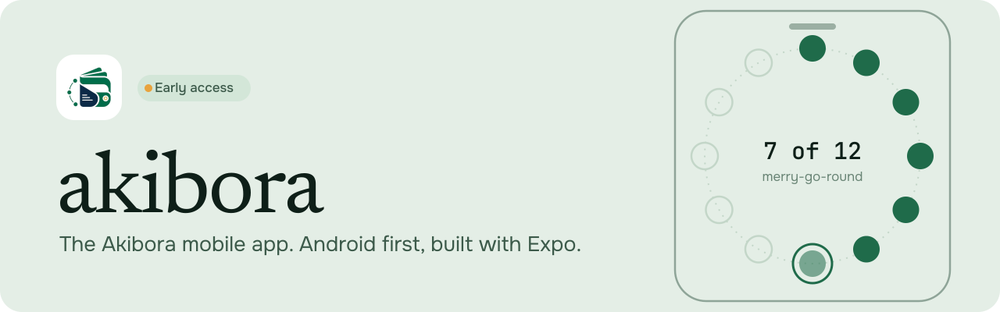
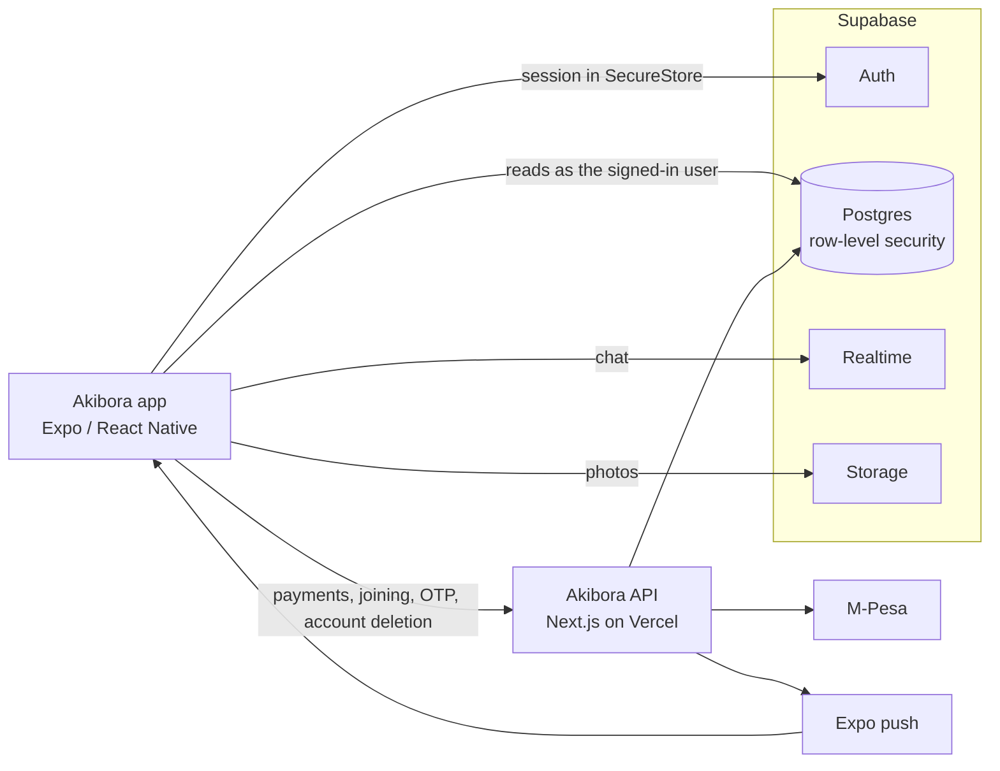
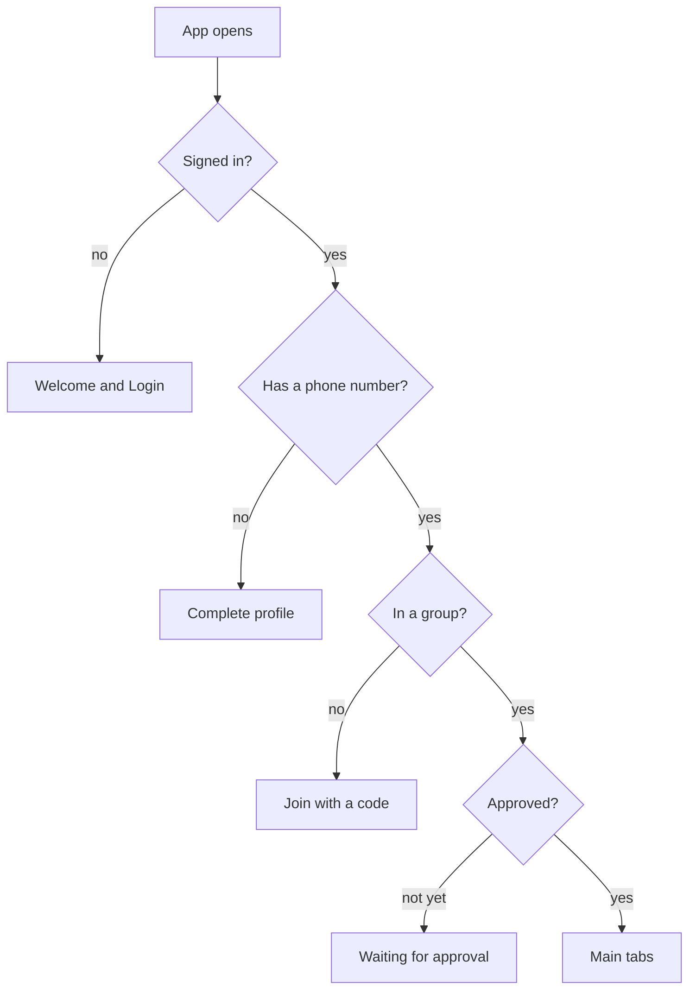

<picture>
  <source media="(prefers-color-scheme: dark)" srcset="docs/assets/banner-dark.svg">
  
</picture>

<p align="center">
  <a href="https://github.com/chillyreward/SmartChama"><b>Web app and API</b></a> ·
  <a href="https://smart-chama10.vercel.app">Live site</a> ·
  <a href="docs/PLAY_STORE.md">Publishing to Google Play</a> ·
  <a href="docs/INTEGRATIONS.md">Integrations</a>
</p>

The Akibora app puts a chama in a member's pocket: pay a contribution with one tap and an M-Pesa prompt, see the group's money and every vote, follow the merry-go-round, and carry a trust score that grows with every month paid on time.

> **Status:** early access, Android first. The app has not launched on Google Play yet. iOS is configured but not built or tested.

This repository is the **mobile app** only. It has no server of its own: it reads the shared Supabase database directly (protected by row-level security) and calls the web app's API in [SmartChama](https://github.com/chillyreward/SmartChama) for anything that moves money or needs a secret. The website and the app use one database and one set of accounts.

## Contents

- [What's in the app](#whats-in-the-app)
- [How it connects](#how-it-connects)
- [Tech stack](#tech-stack)
- [Where things live](#where-things-live)
- [Run it locally](#run-it-locally)
- [Build and install](#build-and-install)
- [Configuration](#configuration)
- [Security](#security)
- [Design](#design)
- [What's not done yet](#whats-not-done-yet)
- [Team and licence](#team-and-licence)

## What's in the app

| Tab | What you do there |
| --- | --- |
| **Home** | What you've saved, what's due next, whose turn it is on the merry-go-round |
| **Wallet** | The group balance, loans, and voting on withdrawal requests |
| **Pay** | The green button in the middle: pay a contribution over M-Pesa and watch it confirm |
| **Chat** | The group's own chat, live |
| **More** | Merry-go-round, welfare, members, history, trust score and credit passport, analytics, alerts, SmartGrow, profile and settings |

Also:
- **Sign-in:** email and password, phone and SMS code, Google and Apple.
- **Groups:** join one or more groups with a code, and switch between them.
- **Look:** light and dark themes, a branded loading screen, and a first-run tour with Hammy.
- **Security:** an app lock with fingerprint or face, and PDF statements officials can share.

## How it connects



All API calls go through [`src/lib/api.ts`](src/lib/api.ts) and carry the user's Supabase token. The server checks it before doing anything.

## Tech stack

| Layer | What we use |
| --- | --- |
| Runtime | Expo SDK 57, React Native 0.86, React 19, TypeScript |
| Navigation | React Navigation (native stack and a custom bottom tab bar) |
| Data | Supabase JS, TanStack Query (only public data is cached to disk) |
| Storage | `expo-secure-store` for the session, AsyncStorage for harmless settings |
| Native | `expo-local-authentication` (app lock), `expo-print` and `expo-sharing` (PDF statements), `expo-notifications`, `expo-updates` |
| Drawing | `react-native-svg` (ring, meters, Hammy) |
| Fonts | Newsreader, Onest and JetBrains Mono via `@expo-google-fonts` |
| Builds | EAS Build and EAS Update |

## Where things live

```text
App.tsx                    providers, app lock, loading screen
src/
├── navigation/            AppNavigator (who sees which screens) and MainTabs (the tab bar)
├── screens/               one file per screen: Dashboard, Contributions, Wallet, Chat, More …
├── ui/                    the design kit: T, Money, Panel, Button, Chip, Ring, Meter, Row …
├── components/            AppTour, Hammy, BrandLoader, GroupSwitcherModal, OfflineBanner
├── contexts/              AuthContext (session, groups, switching) and ThemeContext
├── lib/                   supabase client, API client, query cache, trust score, logger
├── security/              AppLock, biometrics, screen-capture protection
├── integrations/          M-Pesa, push and OTA updates behind one interface (see docs/INTEGRATIONS.md)
├── config/                env.ts (checked at start-up) and features.ts (feature flags)
├── theme/                 colours and fonts
└── utils/pdfExport.ts     member statements as PDF
```

How a signed-in person is routed ([`AppNavigator.tsx`](src/navigation/AppNavigator.tsx)):



## Run it locally

You need Node 20 or newer, the Expo tools, and the Android Studio emulator or a phone with Expo Go.

```bash
git clone https://github.com/chillyreward/SmartChama-Mobile.git
cd SmartChama-Mobile
npm install
cp .env.example .env        # point it at the Supabase project and the web API
npx expo start              # press a for Android, or scan the QR code with Expo Go
```

| Command | Does |
| --- | --- |
| `npx expo start` | Start the dev server |
| `npm run android` | Build and run a native debug build on a device or emulator |
| `npx tsc --noEmit` | Type check |
| `npx expo export --platform android` | Check that the JavaScript bundle builds |

## Build and install

Builds run on Expo's servers under the account `chilly_reward1`. Profiles are in [`eas.json`](eas.json).

| Profile | Command | You get |
| --- | --- | --- |
| `development` | `eas build -p android --profile development` | A dev client with demo logins switched on |
| `preview` | `eas build -p android --profile preview` | An APK to install straight on a phone |
| `production` | `eas build -p android --profile production` | An app bundle for Google Play (see [docs/PLAY_STORE.md](docs/PLAY_STORE.md)) |

```bash
npm install -g eas-cli
eas login
eas build -p android --profile preview
```

When the build finishes, open its link on your phone and install the APK. The Android package is `co.ke.akibora.app`.

## Configuration

Settings come from `EXPO_PUBLIC_*` variables: `.env` when running locally, and the `env` block of each profile in `eas.json` for builds. [`src/config/env.ts`](src/config/env.ts) stops the app at start-up if one is missing or isn't HTTPS.

| Variable | What it is |
| --- | --- |
| `EXPO_PUBLIC_SUPABASE_URL` | The shared Supabase project |
| `EXPO_PUBLIC_SUPABASE_ANON_KEY` | Its publishable key (`sb_publishable_…`). Public by design; row-level security protects the data |
| `EXPO_PUBLIC_API_BASE_URL` | The web app, which serves the API |
| `EXPO_PUBLIC_SUPPORT_EMAIL` | Shown in Help |
| `EXPO_PUBLIC_APP_ENV` | `development`, `preview` or `production` |
| `EXPO_PUBLIC_FEATURE_*` | Feature flags, listed in [`features.ts`](src/config/features.ts) |

No secret ever goes in this app. Anything secret lives on the server.

## Security

- **Session storage:** the session is kept in the phone's secure store, not plain storage.
- **App lock:** the app locks after a minute in the background and opens with fingerprint, face or the phone's PIN.
- **Screenshot protection:** the wallet and payment screens block screenshots and screen recording.
- **No sensitive caching:** balances and statements are never cached to disk. Only queries marked public are kept offline.
- **Re-confirmation for big actions:** deleting your account needs biometric confirmation, and it erases personal details while keeping the group's financial record.
- **Server-side money:** every money action is checked again on the server and in the database. The app can't move money on its own.

## Design

The app shares the website's design. Colours are in [`src/theme/colors.ts`](src/theme/colors.ts): forest `#0E1F18`, mint `#7CE3A6`, sage `#D5E3D7`, lavender `#C7BAF5`. The light theme uses light green rather than white, and the dark theme uses dark green. Headings are set in Newsreader, text in Onest, and money in JetBrains Mono. Screens are built from the kit in [`src/ui`](src/ui) rather than one-off styles.

## What's not done yet

- **Google Play:** not published yet. The checklist is in [docs/PLAY_STORE.md](docs/PLAY_STORE.md).
- **iOS:** configured, but not built or tested.
- **AI assistant:** behind a feature flag and off.
- **SmartGrow and M-Pesa payouts:** waiting on the same steps as the web app (licensed partners, Safaricom B2C).

## Team and licence

Built by Lenny Kidavi ([@chillyreward](https://github.com/chillyreward)) and Sheila.

Proprietary. Copyright © 2025–2026 Lenny Kidavik. All rights reserved. See [LICENSE](LICENSE).
